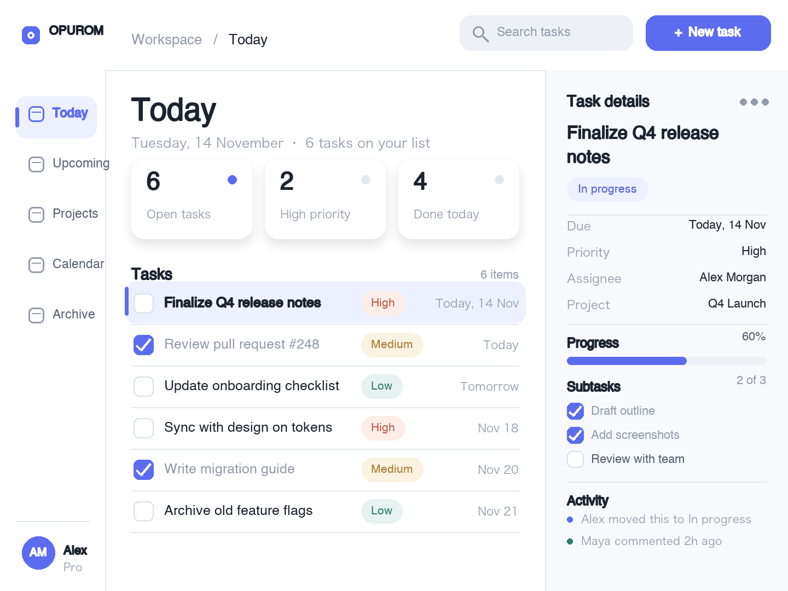
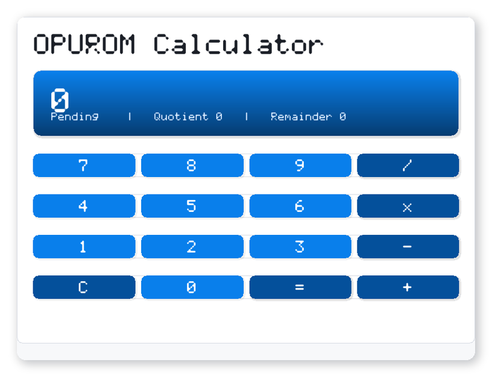
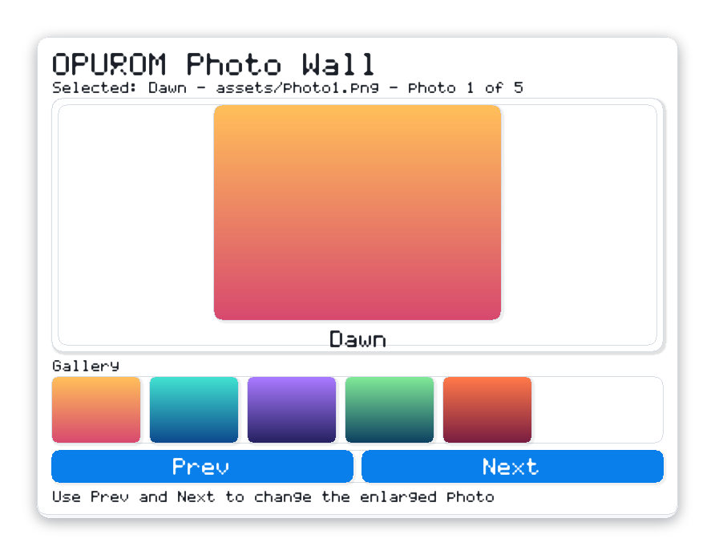
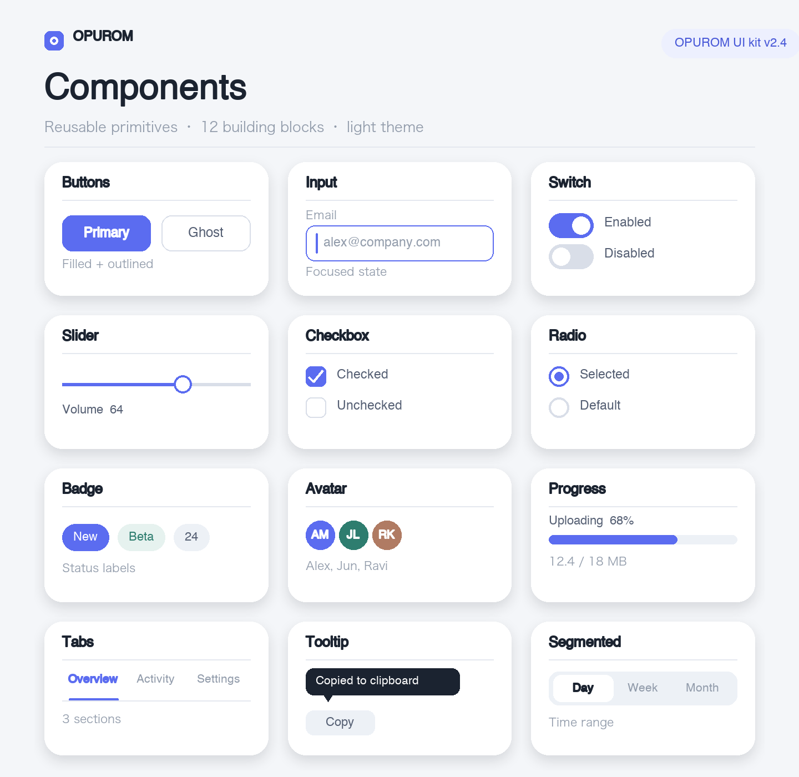
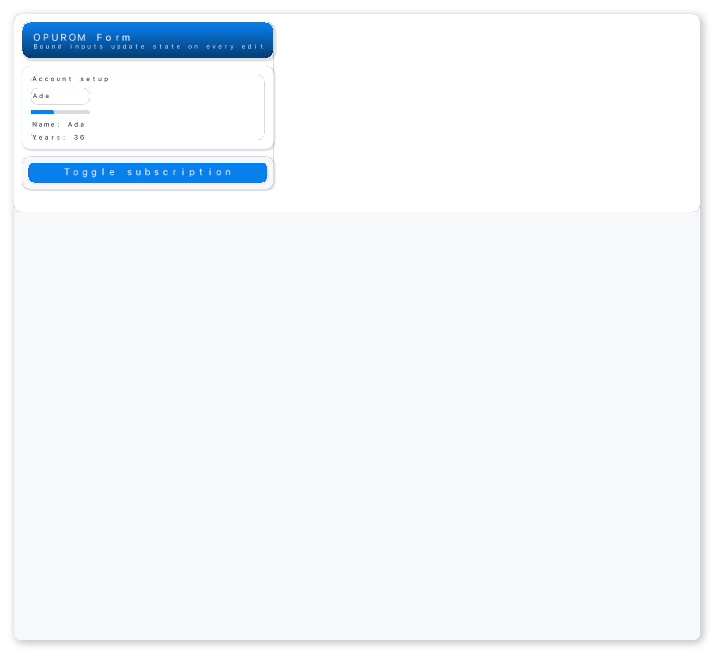
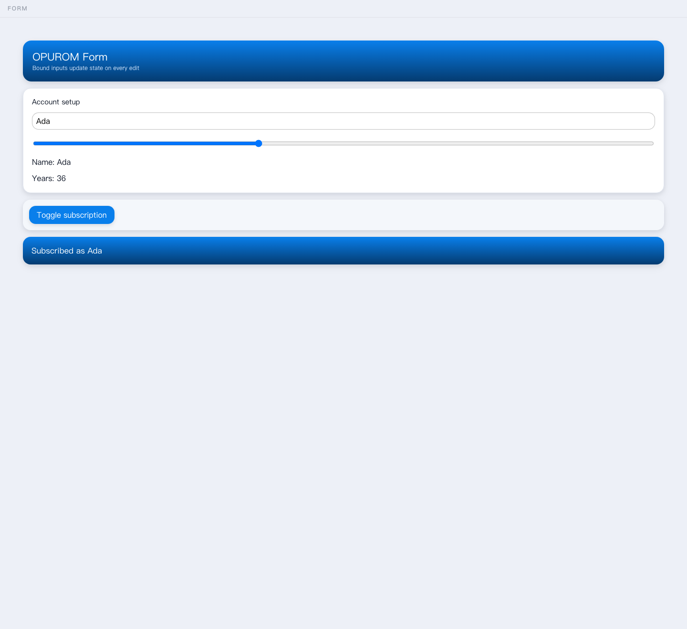

# OPUROM Examples

Example applications for the OPUROM framework, a registry that describes them to the toolchain,
and the cross-project verification harness. Each `.opu` file is a complete program that compiles
to IR and renders through the framework's own pipeline, so every example is a runnable instance of
the framework rather than a sketch.

## Applications

Each entry names the example and the one thing it is built to show. The examples are ordered from
the smallest program to the richest multi-device application.

| Application | What it builds and shows |
| --- | --- |
| [counter.opu](counter.opu) | The canonical frontend program: one integer state, `+`/`-` buttons wired through `add`, a nested layout and `{count}` interpolation. |
| [profile.opu](profile.opu) | String and `bool` state with input binding, `set` and `toggle`, showing how a single input drives both text and a switch. |
| [todo.opu](todo.opu) | The full-stack application: a UI, a `model` and two HTTP API routes in one source file, plus its reference [IR](todo.opuir.json). |
| [showcase.opu](showcase.opu) | The component catalog in one screen: accessibility properties, visual effects and a dark-mode panel, all driven by catalog components. |
| [gallery.opu](gallery.opu) | Every distinct primitive kind the renderer supports, one instance per kind and grouped by family, as a completeness map of the rendering surface. |
| [calculator.opu](calculator.opu) | Positional digit entry and integer arithmetic: computed expressions supply `+`, `-` and `x`, and a `=` branch applies the pending operator. |
| [photos.opu](photos.opu) | A responsive image gallery where `Next`/`Prev` change the selected image through string and int state plus mutually exclusive bool gates. |
| [animation.opu](animation.opu) | Deterministic entry animation: spring, ease and a static panel share one fixed-timestep clock, so the same tick always yields the same frame. |
| [motion.opu](motion.opu) | A flagship interaction sample: cards spring in on load, a bound slider scrolls a value with an eased readout, and a tap springs an expanding panel open. |
| [form.opu](form.opu) | Input binding, computed values and conditional rendering in one program: bound inputs update state on every edit and a panel appears on toggle. |
| [typography.opu](typography.opu) | Global theme `fontScale` with a per-node override, showing how one scale rule and one local exception coexist. |
| [particles.opu](particles.opu) | A seeded particle field: a two-stop gradient panel scattered with deterministic dots, no wall clock and no randomness. |
| [field-service.opu](field-service.opu) | The multi-device full-stack board: `model`, `api`, computed values, an adaptive `Grid` and device breakpoints, so one IR reflows between phone and tablet. |
| [workbench/main.opu](workbench/main.opu) | A desktop-class multi-view shell: a navigation rail, stat and task panels and a self-drawn frame in one multi-file project that reflows to a single column on phones. |
| [dashboard/main.opu](dashboard/main.opu) | A production-style telemetry console: KPI cards, a filter sidebar, service rows and conditional panels, in one multi-file project. |
| [dashboard.opu](dashboard.opu) | A compact analytics dashboard: header bar, sidebar navigation, KPI cards, a revenue chart, a recent-activity list and a status footer. |

The canonical frontend IR lives in
[counter.opuir.json](https://github.com/opurom/opurom-spec/blob/main/counter.opuir.json); the
compiler lowers `counter.opu` to a JSON representation equal to it. `todo.opuir.json` is the
checked-in reference IR for the full-stack application and is recompiled from `todo.opu` during
verification.

## Running the examples

From the umbrella workspace root, the CLI lists every registered application and runs their
registered tests in parallel:

```sh
node opurom-cli/bin/opurom.mjs examples
node opurom-cli/bin/opurom.mjs test --examples
```

Filter to one application or control the number of parallel jobs:

```sh
node opurom-cli/bin/opurom.mjs test --examples --filter calculator --jobs 4
node opurom-cli/bin/opurom.mjs test --examples --verbose
```

Each application registers three tests: `check` type-checks the source, `compile` lowers it to
IR, and `render` produces a deterministic PPM frame. The `--verbose` flag prints the output of
every test; the default prints one status line per test followed by a summary.

To run the cross-project harness directly:

```sh
node opurom-examples/test/cross-layer.mjs
```

The harness re-verifies the compiler, renderer, kernel, platform adapters, service, data layer,
toolchain and component catalog together, and exits nonzero if any assertion fails.

The harness compiles every registered application, lowers each IR to every emitter reported by the
compiler, and checks that each emitted artifact is present and non-empty; emitted JavaScript is
syntax-checked and emitted JSON is parsed. A companion check passes a registry entry whose source
file does not exist and an incomplete artifact list to the same code path, asserting that both are
rejected.

## Application previews

Each preview is the deterministic frame the renderer produces for that example at the registered
viewport, produced by the same pipeline that runs in the browser and on the native targets.













## Registry format

`examples.json` follows a CMake-style registration model. Each application declares its name,
source path, target emitters and an ordered list of tests. Commands use `{source}` and `{tmp}`
placeholders plus tool aliases resolved by the CLI at runtime, so the same registry works on any
host with the toolchain installed.

```json
{
  "version": 1,
  "apps": [
    {
      "name": "counter",
      "source": "counter.opu",
      "required": true,
      "targets": ["web", "native"],
      "tests": [
        { "id": "counter.check", "cmd": ["opuromc", "check", "{source}"],
          "description": "type-check the source with opuromc" }
      ]
    }
  ]
}
```

Adding an application means adding its source file and one registry entry; the CLI then includes
it in `examples` and `test --examples` without further configuration.

## Reference

- [OPUROM organization](https://github.com/opurom) — framework overview and project index
- [LANG_SPEC.md](https://github.com/opurom/opurom-spec/blob/main/LANG_SPEC.md) — language syntax
- [IR_SCHEMA.md](https://github.com/opurom/opurom-spec/blob/main/IR_SCHEMA.md) — IR contract
- [ARCHITECTURE.md](https://github.com/opurom/opurom-spec/blob/main/ARCHITECTURE.md) — layer boundaries
